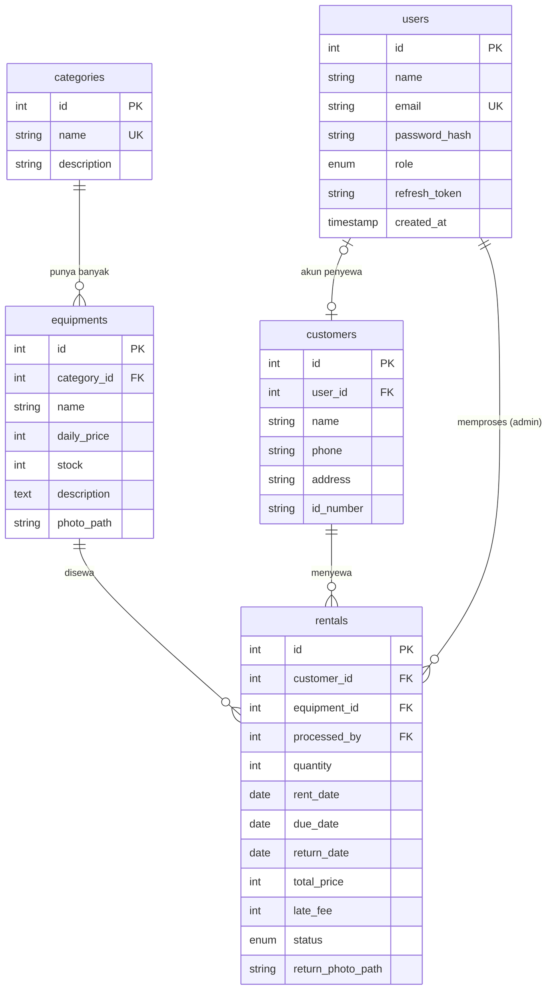

# CampKu - Sistem Rental Alat Camping

Aplikasi Android untuk mengelola rental alat camping: katalog alat, stok, penyewaan, pengembalian, dan denda keterlambatan.

- **Android**: Kotlin, Jetpack Compose (Material 3), Navigation Compose, MVVM (ViewModel + StateFlow + Repository), Retrofit + OkHttp, Coil, DataStore. Tanpa XML layout dan tanpa Room.
- **Backend**: Node.js, Express, MySQL, bcrypt, JSON Web Token, multer.
- Dokumen kebutuhan: [`docs/SRS_CampKu.pdf`](docs/SRS_CampKu.pdf)

## Struktur Proyek

```
CampKu/
├── app/                      Aplikasi Android
│   └── src/main/java/com/example/campku/
│       ├── data/
│       │   ├── model/        Model data (Gson)
│       │   ├── remote/       ApiService (Retrofit), AuthInterceptor (refresh token otomatis)
│       │   ├── local/        TokenStore (DataStore), PhotoStorage (filesDir)
│       │   └── repository/   Repository per fitur
│       ├── ui/
│       │   ├── theme/        Warna & tema
│       │   ├── components/   Komponen UI bersama (form, dialog, foto, state)
│       │   ├── navigation/   Rute + NavHost + menu bawah
│       │   └── auth, home, equipment, category, customer, rental, user, profile
│       └── util/             Format Rupiah/tanggal, validator
├── backend/                  REST API
│   ├── sql/schema.sql        Skema database (ERD)
│   └── src/                  routes, middleware, utils
└── docs/                     SRS
```

## Cara Menjalankan

### 1. Backend

Prasyarat: Node.js 18+ dan MySQL (mis. XAMPP, nyalakan modul MySQL).

```bash
cd backend
npm install
cp .env.example .env      # Windows: copy .env.example .env  (sesuaikan DB_PASSWORD bila perlu)
npm run db:init           # membuat database, tabel, akun admin, dan data contoh
npm start                 # API berjalan di http://localhost:3000
```

Akun admin awal (ubah di `.env`): **admin@campku.com** / **admin123**

Uji logika biaya/denda: `npm test`

### 2. Aplikasi Android

1. Buka folder proyek di Android Studio, tunggu Gradle sync selesai.
2. Alamat server diatur di [`NetworkModule.kt`](app/src/main/java/com/example/campku/data/remote/NetworkModule.kt) pada `baseUrl`:
   - **Emulator**: `http://10.0.2.2:3000/` (sudah default)
   - **HP fisik**: gunakan IP laptop, mis. `http://192.168.1.10:3000/` (HP dan laptop harus satu Wi-Fi, izinkan port 3000 di firewall). Harus diakhiri `/`.
3. Jalankan aplikasi (Run ▶). Login dengan akun admin, atau daftar sebagai penyewa lewat layar Register.

## Peran dan Hak Akses

| Fitur | Admin | Penyewa |
|---|---|---|
| Login, register, profil | Ya | Ya |
| Lihat katalog alat dan kategori | Ya | Ya |
| CRUDS alat dan kategori | Ya | Tidak |
| CRUDS pelanggan dan pengguna | Ya | Tidak |
| Buat pesanan sewa | Ya | Ya (untuk dirinya) |
| Ubah status sewa (Disewa, Dikembalikan) | Ya | Tidak |
| Lihat semua penyewaan | Ya | Hanya miliknya |
| Dashboard laporan | Ya | Tidak |

## Alur Status Sewa

```
Dipesan ──(Admin: Mulai Sewa, stok berkurang)──▶ Disewa ──(Admin: Dikembalikan, stok bertambah, denda dihitung)──▶ Dikembalikan
                                                   │
                                                   └─ lewat tanggal kembali ⇒ penanda "Terlambat" otomatis
```

- **Biaya sewa** = jumlah hari × harga sewa per hari × jumlah alat (sewa dan kembali di hari yang sama dihitung 1 hari).
- **Denda** = hari terlambat × 10% × harga sewa per hari × jumlah alat. Untuk sewa yang masih berjalan, denda tampil sebagai hitungan berjalan sampai hari ini.
- Data sewa hanya dapat diubah selama berstatus **Dipesan** agar stok tetap konsisten.

## Desain Database (ERD)



## Daftar Endpoint REST API

Semua endpoint selain register, login, dan refresh wajib header `Authorization: Bearer <access token>`. Parameter `?search=` dipakai untuk fitur Search. Error selalu berbentuk `{ "message": "..." }`.

| Method | Endpoint | Fungsi | Akses |
|---|---|---|---|
| POST | `/api/auth/register` | Daftar akun | Publik |
| POST | `/api/auth/login` | Login, dapat access + refresh token | Publik |
| POST | `/api/auth/refresh` | Tukar refresh token (rotasi) | Publik |
| POST | `/api/auth/logout` | Hapus refresh token | Login |
| GET | `/api/auth/me` | Data akun sendiri | Login |
| GET | `/api/equipments?search=&category_id=` | Daftar dan cari alat | Login |
| GET | `/api/equipments/popular` | Alat paling sering disewa | Login |
| GET | `/api/equipments/:id` | Detail alat | Login |
| POST, PUT, DELETE | `/api/equipments(/:id)` | Tambah, ubah, hapus alat | Admin |
| POST | `/api/equipments/:id/photo` | Unggah foto alat (field `photo`) | Admin |
| GET | `/api/categories?search=` | Daftar dan cari kategori | Login |
| POST, PUT, DELETE | `/api/categories(/:id)` | Tambah, ubah, hapus kategori | Admin |
| GET / POST / PUT / DELETE | `/api/customers(/:id)?search=` | CRUDS pelanggan | Admin |
| GET | `/api/rentals?search=&status=` | Daftar sewa (Penyewa: hanya miliknya) | Login |
| GET | `/api/rentals/:id` | Detail sewa | Login |
| POST | `/api/rentals` | Buat penyewaan | Login |
| PUT | `/api/rentals/:id` | Ubah penyewaan (status Dipesan) | Admin |
| PATCH | `/api/rentals/:id/status` | Ubah status, stok, dan hitung denda | Admin |
| POST | `/api/rentals/:id/return-photo` | Unggah foto pengembalian | Admin |
| DELETE | `/api/rentals/:id` | Hapus penyewaan | Admin |
| GET / POST / PUT / DELETE | `/api/users(/:id)?search=` | CRUDS pengguna | Admin |
| GET | `/api/dashboard` | Ringkasan: alat tersedia, sewa aktif, terlambat | Admin |

Nilai `status` untuk filter: `dipesan`, `disewa`, `dikembalikan`, `terlambat`.

## Keamanan

- Password di-hash dengan bcrypt; refresh token disimpan di database dalam bentuk hash SHA-256.
- Access token JWT 15 menit, refresh token 7 hari (dirotasi setiap dipakai). `AuthInterceptor` OkHttp memperbarui token otomatis saat menerima 401.
- Endpoint dilindungi middleware JWT dan pengecekan peran. Penyewa hanya dapat mengakses data sewa miliknya.
- Query memakai parameter terikat (aman dari SQL injection).

## File Storage (FR-14)

Foto dari kamera atau galeri diperkecil lalu disimpan ke `context.filesDir/photos`, dibaca kembali dengan File API dan ditampilkan memakai Coil di Detail Alat dan Detail Sewa. Salinannya juga diunggah ke server (`backend/uploads`). Jika file lokal tidak ada (mis. di perangkat lain), foto dimuat dari server.

## Progres Fitur

- [x] Minggu 1: Setup repo, README, SRS, ERD, project Android + backend kosong, koneksi MySQL - [x] Minggu 2: Backend: register, login, JWT, refresh token, middleware peran - [ ] Minggu 3: Android: tema, navigasi, layar Login dan Register, interceptor token - [ ] Minggu 4: CRUDS Kategori dan Alat (backend + UI + MVVM), unggah foto - [ ] Minggu 5: CRUDS Pelanggan dan Pengguna, role-based UI - [ ] Minggu 6: CRUDS Penyewaan, hitung biaya, stok otomatis, denda, foto pengembalian - [ ] Minggu 7: Dashboard, validasi form, perbaikan bug, rapikan kode dan README

### Checklist Kebutuhan (SRS)

- [x] FR-01 Register · [x] FR-02 Login · [x] FR-03 Refresh token
- [x] FR-04 CRUDS Alat · [x] FR-05 CRUDS Kategori · [x] FR-06 CRUDS Pelanggan
- [x] FR-07 CRUDS Penyewaan · [x] FR-08 CRUDS Pengguna
- [x] FR-09 Hitung biaya · [x] FR-10 Stok otomatis · [x] FR-11 Denda
- [x] FR-12 Status sewa + penanda Terlambat · [x] FR-13 Validasi · [x] FR-14 File storage

