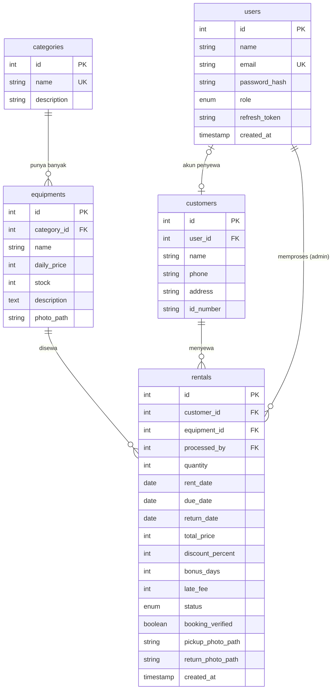

# CampKu - Sistem Rental Alat Camping

Aplikasi Android untuk mengelola rental alat camping: katalog alat, stok, penyewaan, pengembalian, dan denda keterlambatan.

- **Android**: Kotlin, Jetpack Compose (Material 3), Navigation Compose, MVVM (ViewModel + StateFlow + Repository), Retrofit + OkHttp, Coil, DataStore, ZXing (QR Generator & Portrait Scanner). Tanpa XML layout dan tanpa Room.
- **Backend**: Node.js, Express, MySQL, bcrypt, JSON Web Token, multer.
- Dokumen kebutuhan: [`docs/SRS CampKu - Sistem Rental Alat Camping.docx`](docs/SRS%20CampKu%20-%20Sistem%20Rental%20Alat%20Camping.docx) · [`docs/SRS_CampKu.pdf`](docs/SRS_CampKu.pdf)

## Struktur Proyek

```
CampKu/
├── app/                      Aplikasi Android
│   └── src/main/java/com/example/campku/
│       ├── data/
│       │   ├── model/        Model data (Gson)
│       │   ├── remote/       ApiService (Retrofit), AuthInterceptor (refresh token otomatis)
│       │   ├── local/        TokenStore (DataStore), PhotoStorage (filesDir)
│       │   └── repository/   Repository per fitur
│       ├── ui/
│       │   ├── theme/        Warna & tema
│       │   ├── components/   Komponen UI bersama (form, dialog, foto, state)
│       │   ├── navigation/   Rute + NavHost + menu bawah
│       │   └── auth, home, equipment, category, customer, rental, user, profile
│       └── util/             Format Rupiah/tanggal, validator
├── backend/                  REST API
│   ├── sql/schema.sql        Skema database (ERD)
│   └── src/                  routes, middleware, utils
└── docs/                     SRS
```

## Cara Menjalankan

### 1. Backend

Prasyarat: Node.js 18+ dan MySQL (mis. **Laragon** atau XAMPP, nyalakan modul MySQL).

**Cara paling cepat (Windows):** klik 2x file [`start-backend.bat`](start-backend.bat) di root proyek. Script tersebut otomatis menyalin `.env`, menginstal paket, membuat database + data contoh beserta gambar ilustrasi alat, lalu menjalankan server di `http://localhost:3000`.

Atau secara manual melalui terminal:

```bash
cd backend
npm install
cp .env.example .env      # Windows: copy .env.example .env  (sesuaikan DB_PASSWORD bila perlu)
npm run db:init           # membuat database, tabel, akun admin, dan data contoh
npm start                 # API berjalan di http://localhost:3000
```

Akun admin awal (ubah di `.env`): **admin@campku.com** / **admin123**

Uji logika biaya/denda: `npm test`

### 2. Aplikasi Android

1. Buka folder proyek di Android Studio, tunggu Gradle sync selesai.
2. Alamat server diatur di [`NetworkModule.kt`](app/src/main/java/com/example/campku/data/remote/NetworkModule.kt) pada `baseUrl`:
   - **Emulator**: `http://10.0.2.2:3000/` (sudah default)
   - **HP fisik**: gunakan IP laptop, mis. `http://192.168.1.10:3000/` (HP dan laptop harus satu Wi-Fi, izinkan port 3000 di firewall). Harus diakhiri `/`.
3. Jalankan aplikasi (Run ▶). Login dengan akun admin, atau daftar sebagai penyewa lewat layar Register.

## Peran dan Hak Akses

| Fitur | Admin | Penyewa |
|---|---|---|
| Login, register, profil | Ya | Ya |
| Lihat katalog alat dan kategori | Ya | Ya |
| CRUDS alat dan kategori | Ya | Tidak |
| CRUDS pelanggan dan pengguna | Ya | Tidak |
| Buat pesanan sewa | Ya | Ya (untuk dirinya) |
| Ubah status sewa (Disewa, Dikembalikan) | Ya | Tidak |
| Lihat semua penyewaan | Ya | Hanya miliknya |
| Dashboard laporan | Ya | Tidak |

## Alur Status Sewa

```
Dipesan ──(Admin: Verifikasi QR/Kode Booking* + Foto Sebelum Sewa + Mulai Sewa, stok berkurang)──▶ Disewa ──(Admin: Foto Pengembalian + Dikembalikan, stok bertambah, denda dihitung)──▶ Dikembalikan
                                                                        │
                                                                        └─ lewat tanggal kembali ⇒ penanda "Terlambat" otomatis
```
*\*Verifikasi QR / Kode Booking wajib untuk pesanan yang diajukan Penyewa melalui aplikasi; penyewaan yang diinput manual oleh Admin/Kasir otomatis terverifikasi.*

- **Pilih banyak alat sekaligus & Paket Otomatis**: Saat membuat penyewaan baru, pengguna/admin dapat memilih beberapa jenis alat sekaligus melalui dialog katalog visual maupun menggunakan fitur **Paket Otomatis** (input angka manual jumlah orang & durasi), dilengkapi dialog konfirmasi yang langsung mengarahkan ke Detail Sewa.
- **QR Booking Pass, Struk Digital & Bagikan WhatsApp**: QR Booking Pass (`CK-...`) tampil di aplikasi Penyewa untuk ditunjukkan ke kasir. Di sisi Admin, QR dan kode booking disembunyikan (termasuk disamarkan dari respons API) sampai Admin memindai QR (mode Portrait) atau memasukkan kode booking dari penyewa; setelah terverifikasi (atau untuk input manual kasir), Admin dapat mengakses Nota Digital & Kirim WA.
- **Pemisahan riwayat per Tanggal / Bulan / Tahun (2 Tingkat)**: Di halaman **Sewa Saya** (Penyewa) dan **Daftar Penyewa** (Admin), transaksi ditampilkan dalam daftar vertikal per tanggal/bulan/tahun sebelum membuka detail alat agar rapi dan tidak tercampur.
- **Notifikasi In-App & Laporan Pendapatan**: Admin dan Penyewa mendapatkan notifikasi in-app terkait pembaruan status, validasi, dan keterlambatan; Admin juga memiliki Laporan Pendapatan dengan grafik 6 bulan terakhir.
- **Orientasi Layar Portrait**: Seluruh layar aplikasi dan kamera pemindai QR dikunci pada orientasi Portrait.
- **Sistem Diskon & Bonus Hari (Admin)**: Admin dapat memberikan potongan diskon (`0%–100%`) maupun bonus `+1` hari gratis (untuk sewa minimal 2 hari) melalui Form Sewa atau Detail Sewa.
- **Wajib dokumentasi foto sebelum & sesudah sewa**: Perubahan status `Dipesan -> Disewa` mewajibkan foto kondisi alat sebelum disewa (`pickup_photo_path`), dan `Disewa -> Dikembalikan` mewajibkan foto kondisi alat saat dikembalikan (`return_photo_path`).
- **Biaya sewa** = jumlah hari × harga sewa per hari × jumlah alat − diskon (sewa dan kembali di hari yang sama dihitung 1 hari).
- **Denda keterlambatan** = hari terlambat × tarif sewa 1 hari penuh (`harga sewa per hari × jumlah alat`). Untuk sewa yang masih berjalan dan lewat jatuh tempo, denda tampil sebagai hitungan berjalan sampai hari ini.
- Data sewa hanya dapat diubah selama berstatus **Dipesan** agar stok tetap konsisten.

## Desain Database (ERD)



## Daftar Endpoint REST API

Semua endpoint selain register, login, dan refresh wajib header `Authorization: Bearer <access token>`. Parameter `?search=` dipakai untuk fitur Search. Error selalu berbentuk `{ "message": "..." }`.

| Method | Endpoint | Fungsi | Akses |
|---|---|---|---|
| POST | `/api/auth/register` | Daftar akun penyewa baru | Publik |
| POST | `/api/auth/login` | Login, dapat access + refresh token | Publik |
| POST | `/api/auth/refresh` | Tukar & rotasi refresh token baru | Publik |
| POST | `/api/auth/logout` | Hapus refresh token di server | Login |
| GET | `/api/auth/me` | Data profil akun sendiri | Login |
| PUT | `/api/auth/me` | Ubah profil, kontak, alamat, identitas & password sendiri | Login |
| GET | `/api/equipments?search=&category_id=` | Daftar, cari, dan filter kategori alat | Login |
| GET | `/api/equipments/popular` | Daftar 5 alat paling sering disewa | Login |
| GET | `/api/equipments/:id` | Detail alat | Login |
| POST, PUT, DELETE | `/api/equipments(/:id)` | Tambah, ubah, hapus alat | Admin |
| POST | `/api/equipments/:id/photo` | Unggah foto alat (field `photo`) | Admin |
| GET | `/api/categories?search=` | Daftar dan cari kategori | Login |
| GET | `/api/categories/:id` | Detail kategori | Login |
| POST, PUT, DELETE | `/api/categories(/:id)` | Tambah, ubah, hapus kategori | Admin |
| GET | `/api/customers?search=` | Daftar dan cari pelanggan (nama/HP) | Admin |
| GET | `/api/customers/:id` | Detail pelanggan | Admin |
| POST, PUT, DELETE | `/api/customers(/:id)` | Tambah, ubah, hapus pelanggan | Admin |
| GET | `/api/rentals?search=&status=` | Daftar sewa (cari nama/alat/kode booking; Penyewa hanya miliknya) | Login |
| GET | `/api/rentals/code/:code` | Cari & verifikasi penyewaan berdasarkan Kode Booking (`CK-...`) | Login |
| POST | `/api/rentals/:id/verify-booking` | Verifikasi wajib QR / Kode Booking untuk pesanan dari aplikasi | Admin |
| GET | `/api/rentals/:id` | Detail sewa | Login |
| POST | `/api/rentals` | Buat penyewaan (status awal Dipesan) | Login |
| PUT | `/api/rentals/:id` | Ubah penyewaan (hanya status Dipesan) | Admin |
| PATCH | `/api/rentals/:id/status` | Ubah status, stok otomatis, hitung denda (wajib verifikasi QR/kode & foto) | Admin |
| POST | `/api/rentals/:id/discount` | Terapkan potongan diskon (0–100%) pada sewa | Admin |
| POST | `/api/rentals/:id/bonus-day` | Berikan bonus +1 hari gratis (sewa min. 2 hari) | Admin |
| POST | `/api/rentals/:id/pickup-photo` | Unggah foto kondisi alat sebelum disewa | Admin |
| POST | `/api/rentals/:id/return-photo` | Unggah foto kondisi alat saat dikembalikan | Admin |
| DELETE | `/api/rentals/:id` | Hapus penyewaan (kembalikan stok jika Disewa) | Admin |
| GET | `/api/users?search=` | Daftar dan cari pengguna (nama/email) | Admin |
| GET | `/api/users/:id` | Detail pengguna | Admin |
| POST, PUT, DELETE | `/api/users(/:id)` | Tambah, ubah, hapus pengguna | Admin |
| GET | `/api/dashboard` | Ringkasan dashboard laporan | Admin |
| GET | `/api/dashboard/reports` | Laporan pendapatan, grafik 6 bulan & top alat menguntungkan | Admin |
| GET | `/api/notifications` | Notifikasi in-app untuk Admin dan Penyewa | Login |

Nilai `status` untuk filter: `dipesan`, `disewa`, `dikembalikan`, `terlambat`.

## Keamanan

- Password di-hash dengan bcrypt; refresh token disimpan di database dalam bentuk hash SHA-256.
- Access token JWT 15 menit, refresh token 7 hari (dirotasi setiap dipakai). `AuthInterceptor` OkHttp memperbarui token otomatis saat menerima 401.
- Endpoint dilindungi middleware JWT dan pengecekan peran. Penyewa hanya dapat mengakses data sewa miliknya.
- Query memakai parameter terikat (aman dari SQL injection).

## File Storage (FR-14)

Foto dari kamera atau galeri diperkecil lalu disimpan ke `context.filesDir/photos`, dibaca kembali dengan File API dan ditampilkan memakai Coil di Detail Alat dan Detail Sewa. Salinannya juga diunggah ke server (`backend/uploads`). Jika file lokal tidak ada (mis. di perangkat lain), foto dimuat dari server.

## Progres Fitur

- [x] Minggu 1: Setup repo, README, SRS, ERD, project Android + backend kosong, koneksi MySQL
- [x] Minggu 2: Backend: register, login, JWT, refresh token, middleware peran
- [x] Minggu 3: Android: tema, navigasi, layar Login dan Register, interceptor token
- [x] Minggu 4: CRUDS Kategori dan Alat (backend + UI + MVVM), unggah foto
- [x] Minggu 5: CRUDS Pelanggan dan Pengguna, role-based UI
- [x] Minggu 6: CRUDS Penyewaan, hitung biaya, stok otomatis, denda, foto sebelum & sesudah sewa
- [x] Minggu 7: Dashboard, validasi form, perbaikan bug, unit test, rapikan kode dan README

### Checklist Kebutuhan (SRS)

- [x] FR-01 Register · [x] FR-02 Login · [x] FR-03 Refresh token & Logout
- [x] FR-04 CRUDS Alat · [x] FR-05 CRUDS Kategori · [x] FR-06 CRUDS Pelanggan
- [x] FR-07 CRUDS Penyewaan · [x] FR-08 CRUDS Pengguna
- [x] FR-09 Hitung biaya · [x] FR-10 Stok otomatis · [x] FR-11 Denda
- [x] FR-12 Status sewa + penanda Terlambat · [x] FR-13 Validasi · [x] FR-14 File storage · [x] FR-15 Dashboard laporan

